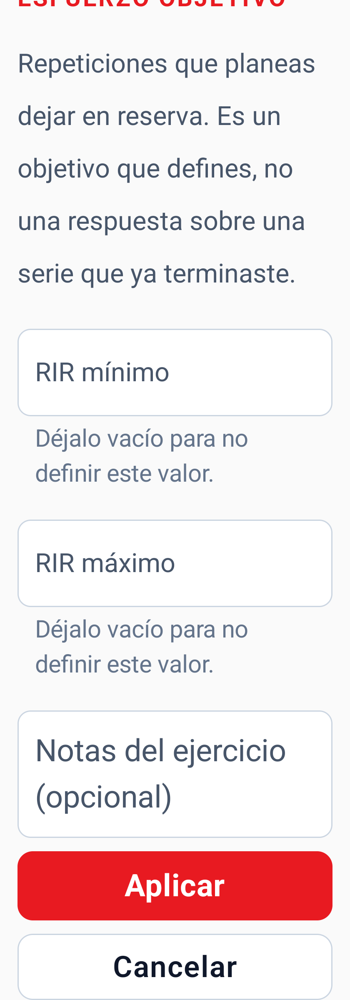
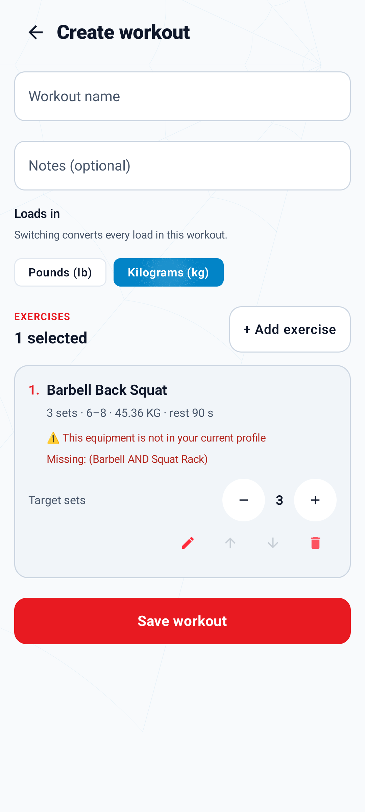
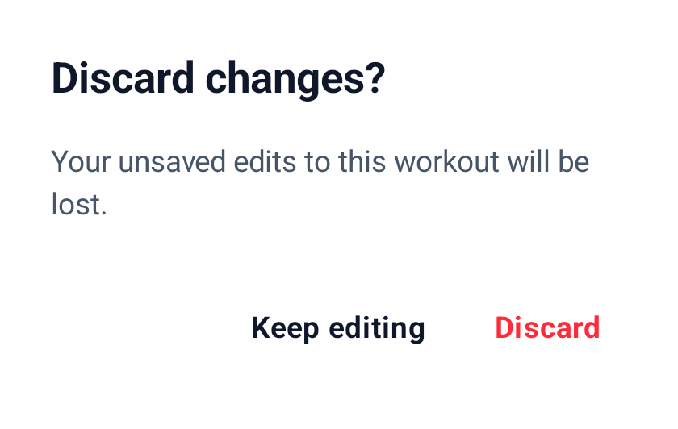

# Custom Workouts

Custom workouts are reusable templates saved entirely on the device. They let a
user choose and order exercises without asking the planner to generate a
recommendation. Starting a template still uses the same active-workout logger,
Room persistence, history, and progress pipeline as a planner-generated workout.

## User flow

1. Open **Today** and select **My Workouts**.
2. Create a workout, then add a name and optional notes.
3. Search the bundled catalog and add exercises.
4. Use the move controls to set exercise order and adjust each set count.
5. Tap the pencil on an exercise (read out as "Edit targets for …") to set its full
   prescription.
6. Save the template locally.
7. Start it from **My Workouts**, log the workout, and finish normally.
8. Reopen it from **Progress** by tapping its completed-workout card. **View all
   workouts** exposes older entries in fixed pages with older/newer controls.

Saved templates can be reopened, edited, started again, or deleted after
confirmation. A template must have a name and between 1 and 50 exercises; at 50 the
add control is disabled and says so beside itself.

## Templates alongside an optional program

Templates remain independent of optional four-week program enrollment. Only an explicit
**Program session** start on Today creates program membership; starting or finishing a
manual template never reserves/advances a slot, changes captured configuration or consumes
an accepted one-workout deload. Templates require no program-header read, so program
configuration/policy failures do not hide this workflow. Ordinary automatic recommendations
are also available through their explicit Today choice.

A completed manual session contributes only its actual eligible work to the same calendar
ledger used by program sessions; enrollment, pause, restart or replacement never clears that
history or creates a second allowance. Any active workout, including a template, blocks
program-management actions until it is finished or cancelled. Resuming an existing active
workout preserves its original provenance rather than associating it with a new program.

## Exercise availability

Both workout sources use the same 302-exercise catalog, but their selection
rules differ intentionally:

| Workout source | Catalog access | Equipment behavior |
| --- | --- | --- |
| Automatic planner | Any catalog exercise that survives hard constraints | Unavailable equipment and profile exclusions remove candidates before planning |
| Manual template | All 302 catalog exercises | A possible equipment mismatch is shown as a warning, but the user may still select the exercise |

Manual selection does not weaken catalog integrity. A template can only store a
known catalog exercise ID with a prescription matching that exercise's type. If
a saved reference cannot be resolved later, WallCrawl reports the error instead
of substituting a different exercise.

Search matches exercise ID, display name, aliases, primary and secondary
muscles, and listed equipment — in every shipped language at once, and
accent-insensitively, so "squat" and "sentadilla" resolve the same catalog IDs
whichever language the interface is in. See
[Localization](localization.md#search). The catalog and illustrations are
bundled, so searching and building templates work offline.

## Default prescriptions

When an exercise is added, `DefaultExercisePrescriptionFactory` supplies a
conservative prescription based on its catalog type and the current profile.
Reviewed programming metadata may enrich that default, but it is not required
for an exercise to be usable. The template editor does not currently apply
historical progression when creating its defaults.

The default is a starting point, not a limit: every field below is editable.

## Editing targets

Each exercise row shows a one-line summary and a pencil button (announced to screen
readers as "Edit targets for" the exercise) that opens a sheet holding only the
fields that exercise type supports:

| Exercise type | Editable targets |
| --- | --- |
| `WEIGHT_REPS` | Sets, repetition range, optional load |
| `BODYWEIGHT_REPS` | Sets, repetition range |
| `ASSISTED_BODYWEIGHT` | Sets, repetition range, optional assistance weight |
| `DURATION` | Sets, duration |
| `DISTANCE_DURATION` | Sets, distance and/or duration |

Rest, an effort target, and per-exercise notes are editable for every type. The
template's own name and notes stay where they were.

<p align="center">
  
</p>

**Unknown is not zero.** Leaving load or assistance empty means the target is
unspecified, and WallCrawl neither guesses a number nor treats it as zero. Typing
`0` is an explicit zero and is stored as one. Clearing a value that was set really
clears it.

**The effort target is a plan, not a report.** It is the repetitions you intend to
leave in reserve. It is a separate thing from the RPE or RIR you record after
finishing a set, and editing one never changes the other.

**Rest provenance follows the value.** A rest time you change is stored as your
explicit preference, so it no longer claims to have come from product policy, and
later automatic planning may reuse it. A rest time you leave alone — or change and
later set back to what it was — keeps exactly the classification and source it was
saved with. The preference contract needs a
rest class as well as the seconds, so a changed value is filed under the nearest
entry of the product's own rest table (short 60 s, moderate 90 s, long 180 s; a tie
goes to the shorter class, and `0` is short). That is a bucket for your number, not
a recommendation: the seconds you typed are what is prescribed.

Numbers are shown and read back with your language's decimal mark, so `2,5` and
`2.5` store the same value. Changing language never converts or re-reads a stored
number.

### Units

A template records the unit its loads and assistance weights are in, and every
weight field is labelled with it. The exception is an older template whose unit was
never recorded: its numbers show no unit until you confirm one (see below).

- **New templates** start in your profile's unit at the moment you open the editor.
  A starting load the app already knows for an exercise is converted into the
  template's unit when you add it.
- **Loads in kg | lb** switches the whole template and **converts** every load and
  assistance value — 100 lb becomes 45.36 kg — rounded to two decimals; a weight too
  small to show in the other unit becomes 0.01 rather than an explicit 0. It is
  refused while a weight field holds something that is not a number yet, or when a
  converted value would be beyond the other unit's limit. Switching
  back restores the exact numbers you had rather than re-converting the rounded ones,
  so a look at the other unit changes nothing — even if you retyped the same number in
  between; a different number typed after switching is converted from that number.
- **Your profile unit is not the template's.** Changing it, even while a draft is
  open, never relabels or converts a template.
- **Templates saved before units were recorded** keep their numbers and have no unit.
  If one carries a load, the editor asks which unit those numbers were entered in.
  Choosing one labels them without changing them; until you do, the template cannot
  be saved or start a new workout (Start still resumes a workout already in progress). A unit whose limit a number exceeds (a load above 4 535.92
  cannot have been kilograms) is refused, with a message beside the unit choices that
  states that limit. A legacy template with no load takes your profile unit, since
  there is nothing to misread.
- **Bounds.** A pound load may be up to 10 000; a kilogram load up to 4 535.92, the
  same limit, so a template stays startable in either unit.

<p align="center">
  
</p>

Editable fields carry two decimal places, the same precision the set logger uses, and
a value typed with more is refused rather than stored, and so is switching units while a
field holds one. A stored value with more — an older version of the editor saved
unit-converted starting loads unrounded, and an archive can carry any value — is shown
rounded to two decimals (a positive value too small to show becomes 0.01, never 0), the
editor says so above the workout, and saving stores the rounded value.

### What is rejected

Editing is validated when you apply one exercise's changes and again for every
exercise before the template is saved. Invalid input is reported on the field it
came from and nothing is silently substituted:

- a blank required field, or a half-typed number such as `60,`;
- a load, assistance or distance with more than two decimal places;
- a maximum below its minimum, in a repetition range or an effort target;
- a value outside the field's range, which the error states — for a kilogram load,
  0–4535.92;
- a number too large to hold, or one that is not finite;
- an effort target with only one of its two values;
- a distance-and-duration exercise with neither a distance nor a duration.

These are the same bounds the domain model enforces. Nothing about the editor
relaxes them.

Targets you enter are your own. Nothing in this flow marks them as reviewed,
clinically validated, or human-approved.

## What is stored

Templates and performed sessions are separate records:

```text
Workout template
  └─ ordered exercise IDs + prescriptions
                    │ Start
                    ▼
Workout session snapshot
  └─ copied exercises + generated sets + origin/source metadata
                    │ Log and finish
                    ▼
Completed workout history
```

Starting a template copies its current definition into a new session. The
session does not read through to the template afterward. The session is recorded
in your profile's unit: a template saved in the other unit has its loads converted
for that session, rounded to two decimals (a load too small to show becomes 0.01 rather
than 0), and the template itself is unchanged.
This means:

- editing a template does not change an active or completed workout;
- deleting a template does not delete workout history;
- a completed workout preserves the targets that were active when it started;
- starting the edited template later uses the new definition.

The session stores `CUSTOM_TEMPLATE` as its origin and retains the template ID
for future attribution. The reference is informational so template deletion is
safe.

Read-only history shows that copied prescription alongside each set's separate
planned targets and recorded results, units, times, notes and optional feedback.
Changing or deleting the template, editing the profile, switching language, or
changing catalog programming cannot rewrite those facts. Missing catalog entries
remain readable by their stored ID and measurements; this does not change the
template editor's missing-reference error behavior.

Manual sessions legitimately have no automatic recommendation record. Detail
says it was not recorded rather than implying automatic validation or inventing
progression/deload reasons. A stored user rest preference can be identified; a
different performed number is not proof of an explicit override. History has no
edit/delete/repeat action. Substitution-specific detail remains dependent on
Package 10.

## Active workout logging

The logger presents fields appropriate to each exercise type:

- load and repetitions;
- bodyweight repetitions;
- assisted repetitions and assistance weight;
- duration;
- distance and/or duration.

Targets and actual results remain separate. The completed result feeds the same
history and progress calculations used by planner-generated workouts and is
available to future workout-generation context.

Only one workout can be active. If the user tries to start a template while a
session already exists, WallCrawl preserves and resumes the existing session
instead of creating competing workouts.

## Unsaved drafts

An edit in progress is held in the editor's saved state, so it comes back after a
configuration change — a rotation, a language switch, a font-size change — and
after Android reclaims the app's process while it is in the background. What comes
back is the name, the notes, the ordered exercises with their identities, every
edited target and exercise note, the template's unit, the open edit sheet, and the
incomplete text in the field that was being typed. A recovered draft is never
overwritten by the editor's own loading.

**This is not storage.** A draft is discarded by uninstalling, clearing app data,
force-stopping the app, swiping it out of the recents list, or restarting the
device. Nothing about a draft is written to the database, an export archive, or a
file. "Delete all data" and restore both run from Profile, which cannot be reached
while the editor is open, and both replace the navigation history, so an old draft
cannot come back afterwards. An edit also checks, as it is written, that its
template still exists.

The saved state was measured on a draft larger than the editor can produce: 50
exercises, every note filled to its length limit with characters that take two UTF-16
units (such as an emoji), every number field, remembered pre-switch value and original
rest at the most characters a field keeps (one more than a valid number can have), an
exercise id longer than the catalog allows, and a recorded rest choice on every row. It
came to 152 112 bytes, under a sixth of the 1 MiB Android allows a whole task's saved
state. An instrumented test prints the measurement on every run, fails if it grows past
that figure, and keeps it under a quarter.

Back from an open exercise picker or an untouched edit sheet closes it first. Once you
have typed in an edit sheet, back, a swipe down and a tap outside it all ask before
dropping that typing; **Cancel** drops it without asking. Leaving the editor with unsaved
changes then asks, on both the toolbar arrow and system back; keeping editing keeps
everything, and leaving happens once however often the arrow is tapped.

<p align="center">
  
</p>

While a save is actually being written the editor is read-only and
cannot be left at all, so a half-written workout is never abandoned; it unlocks
if the save fails and closes when it succeeds. Saving or discarding clears the
draft; a save that fails keeps every field exactly as typed so it can be retried.
A new workout keeps one identity from its first save attempt on, so a retry — even
after the app was recreated — updates the same workout rather than creating a
second, and a repeated tap saves and leaves once. A template that was deleted while you
were editing it is reported rather than quietly saved again as a new one; a draft record
this version of the app cannot read back — one an older or newer build wrote — is reported
and the workout is not saved while that is true, because saving it would drop an exercise;
and an
exercise that can no longer be used as it was saved — gone from the catalog, or still
there under a different type — is flagged on its row rather than dropped, because the
template's prescription has to match the catalog's exercise type.

## Local-first behavior

Templates are stored in the Room database and require no account or network
connection. A saved template survives navigation and process recreation.

Saved templates are included in a user-owned export and come back with a restore,
identifiers, prescriptions, units, effort and rest guidance intact. An archive from
before templates recorded units restores its templates with no unit, exactly as they
were. Because an archive
preserves the exercise identifier a template was saved with, a template can outlive a
catalog change; an identifier the current catalog no longer contains is kept rather
than remapped. Opening such a template fails with a general "couldn't open the workout
editor" message rather than naming the exercise — the reference check runs in the
repository, before the editor has anything to show. The per-row flag for an exercise
that can no longer be used as it was saved — gone from the catalog, or still there
under a different type — applies to a draft recovered from saved state, where the rows
are already on screen. Deleting all local data removes every template along with
everything else. See [Privacy and backup](privacy.md#export-restore-and-deletion).

The current feature does not include:

- exercise supersets or circuits;
- cloud backup or synchronization.

Model-based template analysis and suggestions are not planned features.
The former AI-assistance proposal is retired with
[Roadmap Package 17](../ROADMAP.md#17-optional-local-inference-retired).
Templates remain user-controlled, structured local data; editing and starting them
use the existing deterministic validation and immutable-session boundaries.

## Contributor map

The primary implementation areas are:

All locations below are relative to
`app/src/main/java/wallcrawl/elopenmike/com/`.

| Area | Location |
| --- | --- |
| Domain model and prescription rules | `core/model/WorkoutTemplate.kt`, `core/model/ExercisePrescription.kt` |
| Template persistence | `core/database/repository/WorkoutTemplateRepository.kt`, `WorkoutTemplateDao` |
| Session snapshots and set validation | `core/database/repository/WorkoutRepository.kt` |
| Template screens and state | `feature/templates/` |
| Navigation | `app/WallCrawlApp.kt`, `app/WallCrawlNavigation.kt` |
| Room schema and migration | `core/database/WallCrawlDatabase.kt` |

Tests live beside the corresponding JVM source under `app/src/test/` and under
`app/src/androidTest/` for Room and packaged-asset behavior. See
[WallCrawl Architecture](architecture.md) for the complete data flow and
[Build and test](../README.md#build-and-test) for verification commands.
